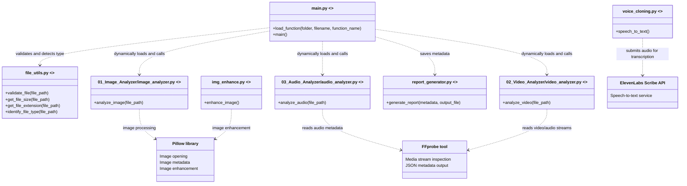
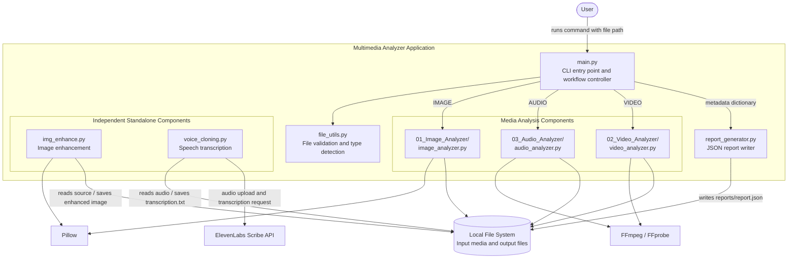
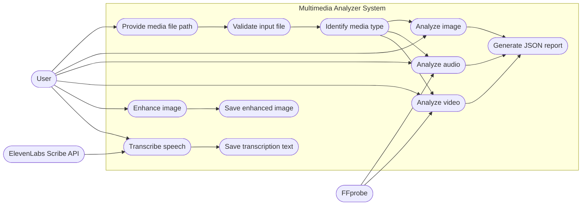
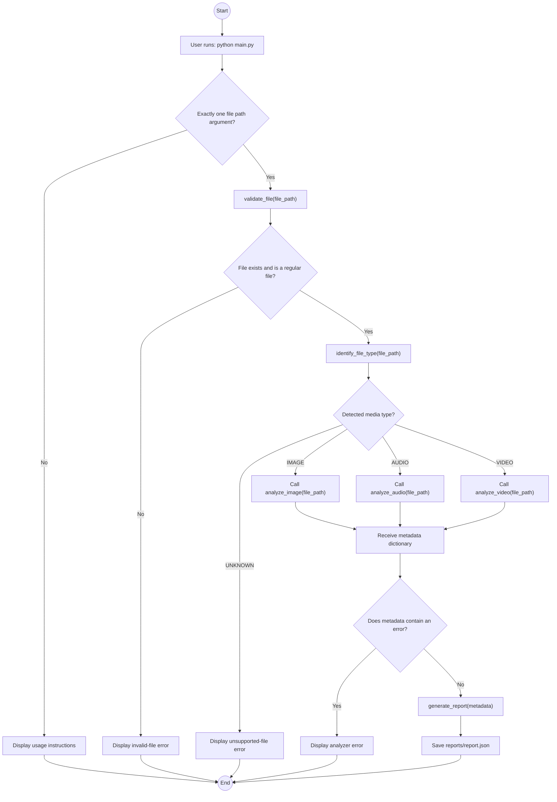
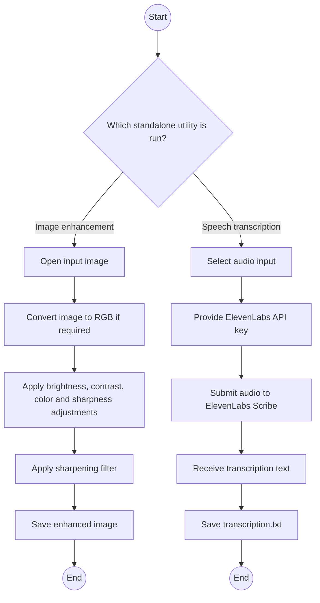
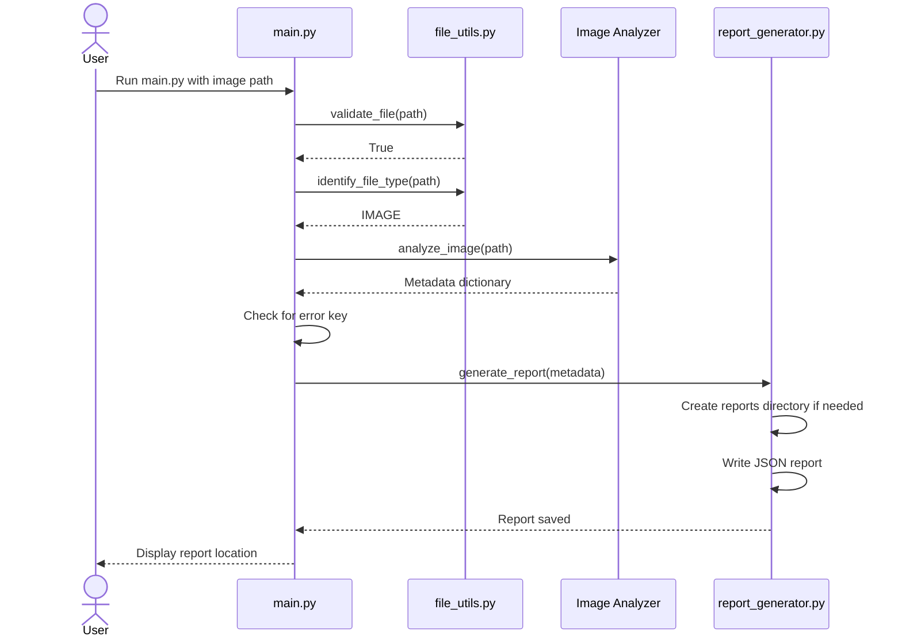
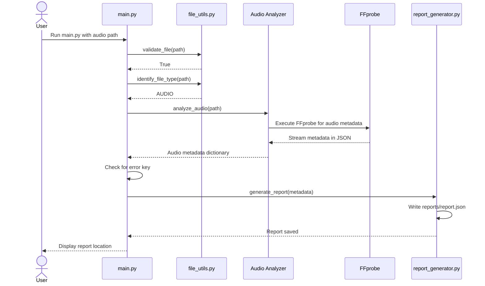
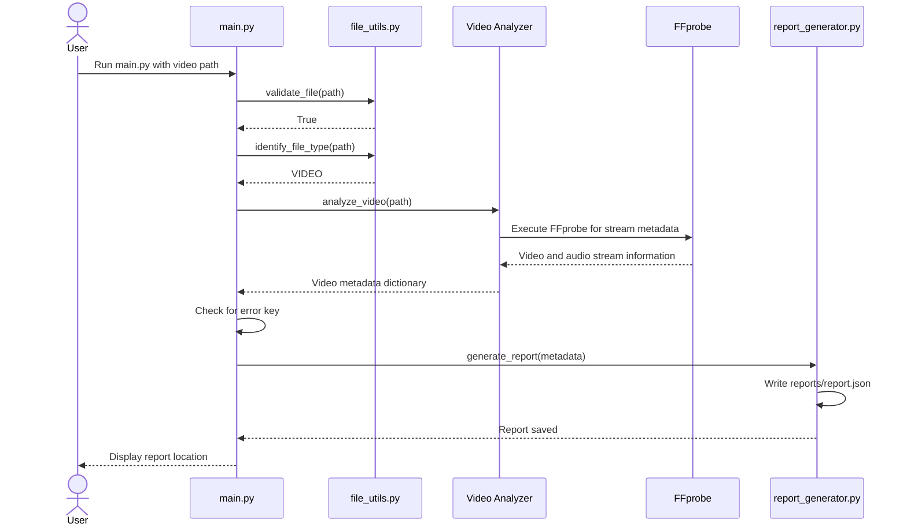
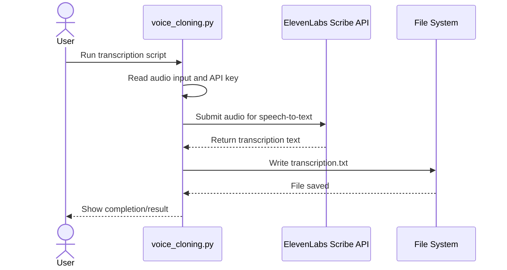

# UML Diagrams — Multimedia Analyzer

**Project:** IC-2K22-53 Multimedia Analyzer  
**Author:** Meenakshi Sahu  
**Institute:** IIPS, DAVV  
**Implementation:** Python modules and functions, Pillow, FFmpeg/FFprobe, JSON, ElevenLabs Scribe API

This document presents five UML views of the project. The diagrams describe the implementation visible in the repository: the main analysis workflow is function-based and coordinated by `main.py`; image enhancement and speech transcription are separate, standalone scripts.

## Table of Contents

1. [Class Diagram](#1-class-diagram)
2. [Component Diagram](#2-component-diagram)
3. [Use Case Diagram](#3-use-case-diagram)
4. [Activity Diagram](#4-activity-diagram)
5. [Sequence Diagram](#5-sequence-diagram)

---

## 1. Class Diagram

### Purpose

A UML Class Diagram normally represents the static structure of an object-oriented system: classes, attributes, operations, and relationships. This project is primarily implemented with Python modules and functions rather than user-defined classes. Therefore, the diagram below uses UML `<<module>>` stereotypes as class-like boxes to show each module's responsibilities and public functions. It is a logical structural view, not a claim that these are Python classes.

### Diagram

### Explanation

- **Main module (`main.py`):** Acts as the controller and entry point. It checks command-line arguments, validates the supplied path, identifies the media type, calls the matching analyzer, checks for an error in the returned metadata, and generates a JSON report. It uses `load_function()` and Python's import utilities to load analyzer functions from their respective folders.
- **FileUtils module (`file_utils.py`):** Provides reusable file operations. `validate_file()` checks that the path exists and points to a file. `get_file_extension()` extracts the lowercase extension, while `identify_file_type()` classifies supported extensions as IMAGE, AUDIO, VIDEO, or UNKNOWN.
- **ImageAnalyzer module:** Reads image information such as format, dimensions, and other metadata using the image-processing library.
- **AudioAnalyzer module:** Uses FFprobe to inspect an audio file and obtain audio-stream information.
- **VideoAnalyzer module:** Uses FFprobe to inspect video and audio streams and returns the collected metadata.
- **ReportGenerator module:** Writes the metadata dictionary to a JSON report. The default destination in the code is `reports/report.json`.
- **ImageEnhancer module:** Is a separate script for applying image enhancements. It is not called by the main analysis pipeline.
- **SpeechTranscriber module:** Is a separate script that sends an audio file to the ElevenLabs Scribe service and saves the returned transcription. It is not called by `main.py`.

### Relationships

The main module depends on the utility, analyzer, and report modules. Each analyzer uses the relevant external media tool or library. The enhancement and transcription modules are independent workflows and are not part of the main `main.py` execution sequence.

---

## 2. Component Diagram

### Purpose

A Component Diagram presents the major software building blocks, their responsibilities, and their dependencies. It explains how the user-facing entry point connects to internal modules, external libraries/services, and output files.

### Diagram

### Explanation of Components

| Component | Responsibility |
|---|---|
| `main.py` | Receives the file path from the command line and controls the analysis workflow. |
| `file_utils.py` | Checks whether the file is valid and identifies its type from its extension. |
| Image Analyzer | Extracts image information using Pillow. |
| Audio Analyzer | Uses FFprobe to obtain audio metadata. |
| Video Analyzer | Uses FFprobe to obtain video and embedded audio-stream metadata. |
| Report Generator | Stores the returned metadata in JSON format. |
| Image Enhancer | Independently applies image enhancement operations and saves an output image. |
| Speech Transcriber | Independently submits audio to ElevenLabs Scribe and saves the transcription text. |
| Pillow | External Python library used for image reading, metadata access, and enhancement. |
| FFmpeg / FFprobe | External media tools used to inspect audio and video streams. |
| ElevenLabs Scribe API | External cloud service used for speech-to-text transcription. |
| Local File System | Stores input media and generated outputs such as JSON reports, enhanced images, and transcription text. |

### Component Interaction

For the main workflow, the user supplies a path to `main.py`. The controller asks `file_utils.py` to validate the path and detect the media type. It then calls one matching analyzer. The analyzer returns a metadata dictionary, which is passed to `report_generator.py` for storage. The image enhancement and speech transcription components are separate utilities and are run independently.

---

## 3. Use Case Diagram

### Purpose

A Use Case Diagram describes the system's functional behaviour from the viewpoint of external actors. It identifies who interacts with the system and the services the system provides.

### Actors

1. **User:** Runs the application, provides a media file path, views the analysis result, and can independently run enhancement or transcription.
2. **FFprobe:** External tool used by the audio and video analysis use cases.
3. **ElevenLabs Scribe API:** External service used by the speech transcription use case.

### Diagram

### Explanation of Use Cases

| Use case | Description |
|---|---|
| Provide media file path | The user runs the program and supplies the path of an image, audio, or video file. |
| Validate input file | The system checks that the supplied path exists and refers to a regular file. |
| Identify media type | The system checks the file extension and classifies the file as IMAGE, AUDIO, VIDEO, or UNKNOWN. |
| Analyze image | The image analyzer reads the image and returns its available properties and metadata. |
| Analyze audio | The audio analyzer invokes FFprobe and collects audio-stream information. |
| Analyze video | The video analyzer invokes FFprobe and collects video and audio-stream information. |
| Generate JSON report | The system writes successful analysis metadata to `reports/report.json`. |
| Enhance image | The user runs the independent image-enhancement script to process an image. |
| Save enhanced image | The enhancement script writes the processed image to its output file. |
| Transcribe speech | The user runs the independent transcription script, which sends audio to ElevenLabs Scribe. |
| Save transcription text | The returned transcription is written to a text file. |

### Main and Optional Workflows

The normal analysis workflow is: provide path → validate file → identify type → run the matching analyzer → generate report. If the file is invalid, unsupported, or the analyzer returns an error, the workflow stops without generating a successful report. Image enhancement and speech transcription are separate user-initiated workflows; they are not automatically included in image or audio analysis.

---

## 4. Activity Diagram

### Purpose

An Activity Diagram represents the step-by-step flow of work in a process. It uses actions, decisions, and alternative paths to explain what happens from the beginning to the end of an operation.

### Diagram A — Main Media Analysis Workflow

### Explanation

1. **Start:** The user begins execution by running `main.py` and supplying a file path.
2. **Argument check:** The program checks whether exactly one file path argument was supplied. If not, it displays usage instructions and stops.
3. **File validation:** `validate_file()` checks whether the path exists and is a regular file. An invalid path causes an error message and termination.
4. **File-type detection:** `identify_file_type()` checks the extension and returns IMAGE, AUDIO, VIDEO, or UNKNOWN.
5. **Analyzer selection:** The controller calls only the analyzer corresponding to the detected type.
6. **Metadata response:** The selected analyzer returns a metadata dictionary.
7. **Error check:** If the dictionary contains an `error` key, the error is displayed and the process stops.
8. **Report generation:** If analysis succeeds, `generate_report()` writes the metadata to `reports/report.json`.
9. **End:** The main workflow finishes.

### Diagram B — Independent Utility Workflows

### Explanation

The image enhancement and speech transcription scripts are independent of the main analysis pipeline. The image utility reads an image, applies enhancement operations, and saves a processed image. The transcription utility sends an audio file to the ElevenLabs Scribe service, receives text, and saves the transcription. These operations are started separately by the user.

---

## 5. Sequence Diagram

### Purpose

A Sequence Diagram shows how actors and software components communicate over time. Messages are arranged from top to bottom to represent the order in which operations occur.

### Scenario A — Image Analysis and Report Generation

**Participants:** User, `main.py`, `file_utils.py`, Image Analyzer, `report_generator.py`.

**Explanation:** The user supplies an image path. The main module validates it and identifies it as an image. It calls the image analyzer, receives the metadata, checks for an error, and passes successful metadata to the report generator. The report generator writes the JSON output.

### Scenario B — Audio Analysis and Report Generation

**Participants:** User, `main.py`, `file_utils.py`, Audio Analyzer, FFprobe, `report_generator.py`.

**Explanation:** After validation and type detection, the main module calls the audio analyzer. The analyzer invokes FFprobe to inspect the audio file and returns the parsed metadata. The main module then requests JSON report generation.

### Scenario C — Video Analysis and Report Generation

**Participants:** User, `main.py`, `file_utils.py`, Video Analyzer, FFprobe, `report_generator.py`.

**Explanation:** The video analyzer uses FFprobe to inspect the video file. The returned stream information is assembled into a metadata dictionary and passed back to the main module. On success, the report generator saves the metadata as JSON.

### Scenario D — Independent Speech Transcription

**Participants:** User, `voice_cloning.py`, ElevenLabs Scribe API, File System.

**Explanation:** This is a separate workflow and is not triggered by `main.py`. The user runs the transcription script, which submits the selected audio to ElevenLabs Scribe. The returned text is saved locally.

---

## Overall Project Summary

The five diagrams describe different views of the same Multimedia Analyzer:

- **Class Diagram:** Shows the modules, their main functions, and their dependencies.
- **Component Diagram:** Shows the internal application components and external tools/services.
- **Use Case Diagram:** Shows the functions available to the user and the external actors involved.
- **Activity Diagram:** Shows the decision-making and processing flow for analysis and standalone utilities.
- **Sequence Diagram:** Shows the time-ordered communication for image, audio, video, and transcription scenarios.

**Important implementation note:** The main application currently routes image, audio, and video files through `main.py` and generates a JSON report for successful analysis. Image enhancement and speech transcription are independent scripts, not automatic steps in the main analysis pipeline.

---

*End of UML Documentation — IC-2K22-53 Multimedia Analyzer*
